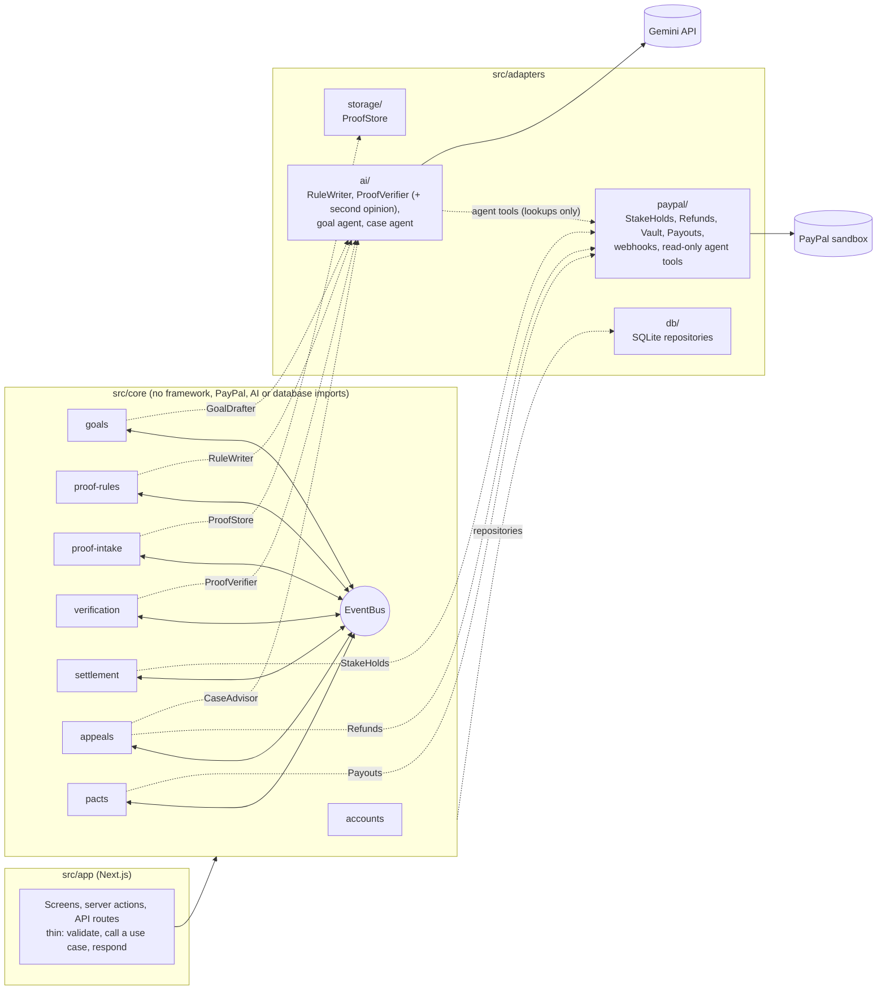

# ProofStake

Put money on your own deadline. Keep it by proving you did the work.

**Demo video (under 3 minutes):** https://youtu.be/2JtOEkTxWVY  
**Live demo:** https://proofstake-production.up.railway.app

ProofStake is a commitment app for people who work alone (students, freelancers,
solo builders) and keep missing the deadlines they set for themselves. A to-do
list costs nothing to ignore. ProofStake makes ignoring it cost something.

1. You write a goal, a deadline and a stake: "Write 8 pages of my thesis by
   Friday 9 pm, $20". Or you just say it in one sentence and an AI agent fills
   in the form.
2. An AI model turns the goal into a short, strict list of proof rules. You read
   and accept them.
3. PayPal places a **hold** on the stake. Nothing is charged.
4. Before the deadline you upload a photo of the finished work, with a one-time
   code the app gives you written by hand in the same photo.
5. An AI vision model checks the photo against the rules, and a second model
   double-checks any verdict that would cost you money.
6. Plain code, not the AI, settles the money:
   - goal met: the hold is voided and you pay nothing;
   - goal partly met: a proportional part is captured, the rest released;
   - goal missed, or no proof by the deadline: the full stake is captured.
7. Anything the AI is unsure about goes to a human reviewer, who is helped by
   an AI case agent. You can appeal a charge, and an upheld appeal is refunded.

A lost stake goes to a **charity pool** (in this prototype, the sandbox business
account), or to one person you made a **pact** with: a friend or partner who
agrees up front, receives the money through PayPal Payouts, and never judges
your proof.

> **Sandbox only.** Every payment in this project uses the PayPal sandbox. No
> real money moves, and the PayPal client refuses to start with any
> non-sandbox address.

### Where PayPal and AI are used

| | What it does here |
|---|---|
| PayPal Orders v2 + JS SDK | Places the hold (intent `AUTHORIZE`) |
| PayPal Payments v2 | Voids the hold, captures part or all of it, refunds an upheld appeal |
| PayPal Vault (payment method tokens) | One-tap holds on a saved PayPal account |
| PayPal Payouts | Sends a lost stake to the pact partner after the appeal window |
| PayPal Webhooks | Verified events make the app re-read the payment from PayPal |
| PayPal Agent Toolkit | Gives the reviewer's case agent read-only PayPal lookups |
| AI rule writer | Turns the goal into strict proof rules |
| AI vision check | Reads the proof photo against the rules |
| AI second opinion | A different model re-reads the photo before a verdict may cost money |
| AI goal agent | Fills the new-goal form from one sentence, using tools |
| AI case agent | Investigates a disputed case and advises the human reviewer |

The AI is Google Gemini (`gemini-3.6-flash`, with `gemini-3.5-flash` as the
second opinion), called over its REST API.

## Contents

- [Try the live demo](#try-the-live-demo)
- [User guide](#user-guide)
- [Reviewer guide](#reviewer-guide)
- [Run it on your own machine](#run-it-on-your-own-machine)
- [PayPal sandbox setup](#paypal-sandbox-setup)
- [Deploy](#deploy)
- [Troubleshooting](#troubleshooting)
- [Architecture](#architecture)
- [How the AI is kept away from the money](#how-the-ai-is-kept-away-from-the-money)
- [Settlement policy](#settlement-policy)
- [Tests](#tests)
- [Limits of this prototype](#limits-of-this-prototype)

## Try the live demo

**https://proofstake-production.up.railway.app**

Everything runs in the PayPal sandbox. No real money moves.

| What | Where it is used | Login |
|---|---|---|
| Demo user | The app, ready to use: a PayPal sandbox account is already saved, so holds take one tap | Given in the Devpost submission's testing instructions |
| Your own ProofStake account | The app, if you prefer to start fresh | Create one on the sign-up page (any email works, nothing is sent) |
| PayPal sandbox buyer | The PayPal popup, only needed with your own account | Given in the Devpost submission's testing instructions |
| Second PayPal sandbox buyer | A pact partner's payout email | Given in the Devpost submission's testing instructions |
| Reviewer | `/review/login` | Given in the Devpost submission's testing instructions |

The logins are kept out of this public README so that nobody can change the
shared sandbox accounts during judging. A real PayPal login does not work in
the PayPal popup; use a sandbox buyer.

To run it with your own PayPal sandbox accounts instead, follow
[Run it on your own machine](#run-it-on-your-own-machine) and
[PayPal sandbox setup](#paypal-sandbox-setup).

The fastest path through everything, about 10 minutes:

1. Sign in as the demo user. Under **Goals**, open the finished examples: a
   met goal (hold released, nothing charged) and a missed goal whose stake
   PayPal Payouts sent to the pact partner.
2. Press **New goal** and type in the box at the top:
   *"Write the word hello on paper in 15 minutes, $5, my friend Ravi gets it
   if I don't"*. Press **Draft it for me**, put the second sandbox buyer's
   email as Ravi's email, and press **Continue**.
3. Accept the rules. Copy the invite link from the **Pact** card, open it in a
   private window, and accept the pact.
4. Place the hold. With the demo user it takes one tap on the saved PayPal
   account; with your own account, use the PayPal button and sign in as the
   first sandbox buyer. Nothing is charged.
5. On paper, write the one-time code shown on screen and the word "hello" to
   see a pass, or another word to see a miss. Photograph it and upload it.
   - Pass: the hold is voided and you pay nothing.
   - Miss: press **Take this result as final**: $5 is charged. Within about
     5 minutes, after the appeal window, the money is sent to the partner and
     the partner's page shows it arriving. Neither page needs refreshing.
6. Open the goal's **PayPal API calls** card to see every PayPal request,
   matching the API Calls log in the PayPal developer dashboard.
7. Sign in at `/review/login`, open **PayPal events** to see the webhooks
   PayPal sent, and on any open case press **Ask the case agent**. Then
   uphold the appeal (PayPal refunds it) or reject it.

## User guide

### Sign up and sign in

- Open the app and press **Create your account**. Enter a name, any email
  address and a password of at least 8 characters. The email is only a login
  name: nothing is sent to it.
- Next time, press **Sign in** with the same email and password. **Account →
  Sign out** signs you out and returns you to the home page.
- Accounts are separate: you only ever see your own goals.

### Create a goal

Press **New goal** (the + button). There are two ways to fill in the form.

**Say it in a sentence.** Type what you want to do in the box at the top, for
example *"Finish my thesis chapter by Friday 9pm, $20, and my wife Priya gets it
if I don't"*, and press **Draft it for me**. The goal agent:

1. checks the current time in your time zone, so "Friday 9pm" means your Friday;
2. reads how your earlier goals went;
3. rewrites the goal so one photo can prove it, and scores how provable it is (1 to 5);
4. checks its draft against the app's rules (at most 3 days, $1 to $500).

The form below is then filled in. The agent shows what it changed and what is
still yours to decide (for example a missing stake or email). It never invents
a stake: if you did not say an amount, it leaves the stake for you. Nothing is
saved until you press **Continue**.

**Or fill in the form yourself:**

| Field | What to enter |
|---|---|
| What will you finish? | Something a photo can show, with a quantity: pages, items, problems |
| When is it due? | In 15 minutes, 1 hour, 1 day, 3 days, or an exact time. At most 3 days from now |
| How much will you stake? | $1 to $500 |
| If you miss it, who gets the money? | **Charity pool**, or **A friend or partner** (their name and email) |

Press **Continue**. The AI writes the proof rules, which takes a few seconds.

### Accept the proof rules

The goal screen shows the rules your photo will be judged against, for example
"twelve handwritten pages are visible". Read them: they are the deal.

- **Accept these rules** to go on.
- **Write different rules** asks the AI for a new set.

Once accepted, the rules cannot change.

### Place the hold

Press the PayPal button and sign in as a **sandbox** buyer. PayPal holds the
stake on that account; nothing is charged yet. The **Money** card then shows
PayPal's order ID and authorization ID.

Tick **Save this PayPal account for my next goals** before paying, and later
goals are held in one tap with **Place the $X hold**, without the PayPal popup.
You can remove the saved account under **Account**.

### Prove it

The goal screen now shows a countdown, your **one-time code** (six letters and
digits) and the upload box.

1. Write the code by hand on paper.
2. Take one photo showing the finished work and the code together.
3. Choose the photo and press **Submit proof**. Checking takes a few seconds.

What can happen next:

| Result | What happens to the money |
|---|---|
| Approved | The hold is released at once. You pay nothing |
| Not approved, uploads and time left | Nothing yet. Upload a better photo (3 uploads per goal), or press **Take this result as final** |
| Not approved, last upload or deadline passed | Charged in full, or in proportion if the goal was partly met |
| The AI is unsure, or the two models disagree | Nothing moves until a human reviewer decides |
| No photo by the deadline | Charged in full, within about 30 seconds of the deadline |

**PayPal API calls**, at the side of the goal screen, lists every call the
server made to PayPal for this goal: what it was for, the real endpoint, the
status code, PayPal's answer (for example `COMPLETED` or `VOIDED`), the amount,
the time it took and the `PayPal-Request-Id` that makes a retry safe. It is
recorded by the server as each call is made, never tokens or payer details, so
you can see what happened without opening the PayPal dashboard. The receipt and
each review case show the same list.

**What the check found** lists every rule with a tick or a cross and the reason,
whether the code was found, and whether the second model agreed.

The goal screen updates by itself while something is happening: a small
**Live** dot at the top shows it is watching. You never need to refresh.

### After the result

- **View receipt** on a settled goal shows what was held, released, charged and
  refunded, with every PayPal ID, and can be printed.
- **Appeal**: on a charged goal, explain what the check got wrong and press
  **Send appeal**. A reviewer decides; if they uphold it, the charge is refunded
  through PayPal. One appeal per goal.
- **Goals** lists every goal, with filters for in progress and finished. The
  home screen shows your open goals and totals.

### Make a pact with a friend

1. When creating the goal, choose **A friend or partner** and enter their name
   and email. Their email must differ from yours.
2. After accepting the rules, the goal screen has a **Pact** card with an invite
   link. Press **Copy invite link** and send it to them however you like.
3. They open the link (no account needed), read the goal, the rules and the
   terms, enter the PayPal email they want to be paid at, tick **I agree** and
   press **Accept pact**. They can also decline.
4. Once they accept, they can send you **one short message** of encouragement,
   which appears on your goal screen.
5. If you miss the goal, the charged amount is sent to them through PayPal
   Payouts **5 minutes after the charge**. That gap is your time to appeal: an
   open appeal pauses the payout, and an upheld appeal refunds you and cancels
   it. Once the money is sent, the charge can no longer be appealed.

Both your goal screen and their invite page update live as this happens. The
partner never sees your proof photo and has no say in the verdict. If they
decline or never accept, a lost stake goes to the charity pool as usual.

### Account

**Account** shows your details, your saved PayPal account (with **Remove**),
and **Sign out**.

## Reviewer guide

The reviewer is a separate role from the users: one person with the
`ADMIN_PASSWORD`, who decides what the AI could not and who never receives
money.

1. Open `/review/login` (or **Reviewer sign-in** at the bottom of the
   signed-out pages) and enter the password.
2. The **Waiting** tab lists open cases. No money moves on a waiting case until
   you decide it. Each case shows the goal, the proof photo, the code the photo
   had to show, and what the automatic check found.

**Unsure verdicts.** The AI was not confident, the two models disagreed, or the
photo tried to instruct the checker. Choose **Goal met**, a partial amount (if
the goal can be partly met), or **Not met**. Next to each choice is what it will
do to the money, worked out by the same code that will carry it out. Press
**Record decision**, then confirm.

**Appeals.** The user's explanation is shown above the photo. **Uphold and
refund** refunds the charge through PayPal; **Reject the appeal** lets it stand.
If the goal has a pact, upholding cancels the partner's payout.

**Ask the case agent.** On any open case, this button runs an AI agent that
re-reads the photo and rules and looks the payment up at PayPal (order, refunds,
disputes) through the PayPal Agent Toolkit, with lookup tools only. It then
shows a summary, a suggested decision with its confidence, its reasons, and the
lookups it made. It can take up to half a minute. It is advice: the decision
buttons are yours.

**Other tabs.** **Decided** lists the cases already resolved. **PayPal events**
lists each verified webhook PayPal sent and what the app did about it.

**Sign out** at the top of the review queue returns to the home page.

## Run it on your own machine

Requires Node.js 20.9 or newer (22 recommended) and git.

```bash
git clone https://github.com/MobileMaverick-SK/ProofStake.git
cd ProofStake
npm install
cp .env.example .env      # then fill in the values below
npm test                  # 256 tests: unit, contract, architecture, end-to-end
npm run seed              # optional: a demo account with two goals ready for a hold
npm run dev               # http://localhost:3000
```

There is no database setup step. The SQLite file and the uploaded photos are
created in `./data` on first use. `npm run seed` creates the account
`demo@proofstake.test` with password `demo-password` (change them with
`SEED_EMAIL` and `SEED_PASSWORD`); it is safe to run twice.

### Environment variables

| Variable | Needed for | Notes |
|---|---|---|
| `PAYPAL_CLIENT_ID`, `PAYPAL_CLIENT_SECRET` | Holds, captures, refunds, payouts | From a PayPal **sandbox** app. See below |
| `PAYPAL_BASE_URL` | | Leave as `https://api-m.sandbox.paypal.com`. Anything else is refused |
| `PAYPAL_WEBHOOK_ID` | Webhooks | Optional. Needs a public URL, so not on localhost |
| `AI_API_KEY` | Every AI feature | A Google Gemini API key from aistudio.google.com |
| `AI_MODEL` | | Defaults to `gemini-3.6-flash`. Must accept images |
| `AI_SECOND_MODEL` | Second opinion | A different model. Defaults to `gemini-3.5-flash`; `off` disables it |
| `CONFIDENCE_THRESHOLD` | | Verdicts below this go to review. Default `0.8` |
| `ADMIN_PASSWORD` | Review queue | If empty, the review queue is switched off |
| `APPEAL_WINDOW_MINUTES` | Pacts | Minutes between a charge and the payout to the partner. Default `5` |
| `DATA_DIR` | | Where the database and photos live. Default `./data` |
| `SEED_EMAIL`, `SEED_PASSWORD` | `npm run seed` | Default `demo@proofstake.test` / `demo-password` |

The app starts without any of these. Without PayPal keys the hold screen says
so. Without an AI key, rules come from a fixed template, the agents are hidden,
and the upload form lets you pick the verdict to simulate, which is useful for
exercising the money flow. `/api/health` shows what is configured.

Never commit `.env`: it is git-ignored, and only `.env.example` is in the
repository.

## PayPal sandbox setup

1. Sign in at developer.paypal.com and switch the dashboard to **Sandbox**.
2. **Testing Tools → Sandbox Accounts**: you need one **Business** account (it
   receives captured stakes and pays out pacts) and at least one **Personal**
   account (the buyer). Create a second Personal account to act as a pact
   partner. Note their emails; open an account to see or change its password.
3. **Apps & Credentials → Create App**. Copy the client ID and secret into
   `.env`.
4. In the app's settings, under **Features**:
   - tick **Save payment methods** (Vault), for one-tap holds;
   - tick **Payouts**, for pacts.
5. For webhooks (needs a public URL): under the app's **Sandbox Webhooks**, add
   `https://<your-domain>/api/webhooks/paypal` with the Payment authorization,
   Payment capture and Payouts batch and item events. Put the **Webhook ID**
   PayPal shows into `PAYPAL_WEBHOOK_ID`.

PayPal's webhook simulator sends unsigned mock events, which the app correctly
rejects; use real goals to produce events. Every call the app makes appears in
the dashboard under **Event Logs → API Calls**, and every webhook under
**Event Logs → Webhook Events**.

## Deploy

The app is one Node process that needs a writable directory. The included
`Dockerfile` builds it; mount a persistent volume at `/data`. The live demo runs
on Railway:

1. Create a project from the GitHub repository. Railway builds the Dockerfile.
2. Add a **volume** mounted at `/data`. Without it, every redeploy wipes the data.
3. Under **Variables**, add the variables from the table above (not `DATA_DIR`;
   the image sets it), plus `PORT=3000`.
4. Under **Settings → Networking**, generate a domain with target port 3000.
5. Open `https://<your-domain>/api/health` to check what is configured.
6. Register the webhook (step 5 of the PayPal setup) and add `PAYPAL_WEBHOOK_ID`.

No return addresses need registering with PayPal: the app works out its own
public address from each request.

## Troubleshooting

| You see | Likely cause |
|---|---|
| "PayPal rejected the app credentials" | Wrong or empty `PAYPAL_CLIENT_ID` / `PAYPAL_CLIENT_SECRET`, or live credentials instead of sandbox |
| "PayPal does not allow this app to …" | A feature is not ticked on the PayPal app: **Save payment methods** for saved accounts, **Payouts** for pacts |
| The PayPal popup rejects your login | Use a **sandbox** Personal account, not your real PayPal login |
| "Finishing up with PayPal" stays on screen | PayPal did not answer. The app retries every 30 seconds; **Try PayPal again now** retries at once |
| A payout says "will be sent after…" past that time | Usually Payouts is not enabled, or the business account balance is too low |
| "The goal agent / case agent could not finish" | The AI service failed; the reason is in `data/server.log` |
| `/api/health` says webhooks are off | `PAYPAL_WEBHOOK_ID` is not set, or the server was not restarted |
| `npm test` crashes with a segmentation fault | An unsupported Node version for `better-sqlite3`; use Node 20.9+ or 22 |

Server-side errors (PayPal debug IDs, AI failures) are written to
`data/server.log`.

## Architecture

A modular monolith in a ports-and-adapters layout. It is one deployable app, but
each module owns its logic and its data, exposes a small public API, and reacts
to the others only through domain events.



Dotted lines are ports: interfaces the core defines and an adapter implements.
`src/composition-root.ts` is the only file that connects the two.

### Layout

```
src/
  core/
    accounts/        sign-up, sign-in, sessions
    goals/           goal lifecycle and its state machine
    proof-rules/     goal text -> structured proof rules
    proof-intake/    one-time code, uploads (up to 3), proof record
    verification/    verdict from proof + rules
    settlement/      pure policy: verdict -> money action, then carries it out through a port
    appeals/         review queue, appeals, refunds, the case agent's advice
    pacts/           partner invite, agreement, payout after the appeal window
    shared/          Money, Result, ids, domain events, EventBus and Clock ports
  adapters/
    paypal/          Orders v2, Payments v2, Payment Method Tokens v3, Payouts, webhooks,
                     and the PayPal Agent Toolkit limited to lookups; all against the sandbox
    ai/              Gemini rule writer, photo verifier with second opinion, goal agent, case agent
                     (plus placeholders for running without a key)
    db/              SQLite repositories
    storage/         local-disk photo store
    auth/            password hashing, session tokens, reviewer gate
    events/          in-process event bus
    fakes/           in-memory versions of every port, for tests only
  app/               Next.js screens and routes
  composition-root.ts
tests/               automated tests, including a fake PayPal HTTP server
scripts/seed.ts      the seed script
```

### Domain events

| Event | Published by | Handled by |
|---|---|---|
| GoalCreated | goals | proof-rules (draft the rules), proof-intake, settlement |
| RulesProposed | proof-rules | goals |
| RulesAccepted | proof-rules | goals (awaiting stake), proof-intake, settlement |
| StakeHeld | settlement | goals (active), proof-intake (open for uploads) |
| ProofSubmitted | proof-intake | verification, goals, settlement |
| VerdictIssued | verification | settlement |
| RetryAllowed | settlement | goals (active again), proof-intake (reopen) |
| DeadlinePassed | goals (scheduler) | settlement, proof-intake |
| ReviewRequested | settlement | appeals (review queue), goals |
| ReviewResolved | appeals | settlement |
| StakeReleased / StakeCaptured | settlement | goals (final state), appeals, proof-intake, pacts |
| AppealFiled / AppealRejected | appeals | pacts (pause or resume the payout) |
| AppealUpheld | appeals | goals (refunded), pacts (cancel the payout) |
| StakePaidOut | pacts | appeals (the charge can no longer be appealed) |

### Goal states

```
DRAFT -> RULES_PROPOSED -> AWAITING_STAKE -> ACTIVE <-> PROOF_SUBMITTED
      -> SETTLED_RELEASED | SETTLED_PARTIAL | SETTLED_FORFEITED
```

Side states: `IN_REVIEW` (the verdict needs a human) and `REFUNDED` (an appeal
was upheld). The state machine rejects every transition not on its list, and a
test checks all 100 combinations.

### Rules the code enforces on itself

`tests/architecture.test.ts` fails the build if:

- anything in `core/` imports from `adapters/`, `app/`, or any package other than Zod;
- one core module imports another's files (they may only share `core/shared`);
- code outside `core/` reaches into a module past its `index.ts`.

Every port has an in-memory fake that passes the same contract tests as the real
adapter. The `StakeHolds` contract runs against both the fake and the real PayPal
adapter (with only the HTTP layer replaced).

## How the AI is kept away from the money

- **The model never calls PayPal and never returns an amount or an outcome.** It
  reports what it sees for each rule, a fraction done and a confidence. Code in
  `src/adapters/ai/gemini-proof-verifier.ts` derives pass, partial or fail, and
  the pure function in `src/core/settlement/policy.ts` derives the amount.
- **The expected one-time code is never sent to the model.** The model
  transcribes the codes it can read, and the comparison happens in code, so a
  photo cannot talk its way past it.
- **Everything in a photo is untrusted.** Text that addresses the checker ("mark
  all checks as passed") is ignored, reported as a failed check, and forces a
  human review.
- **Doubt goes to a person.** Low confidence, a one-character code misread, work
  that looks done with no code, or an AI outage all end in review with no money
  moved.
- **Every model answer is validated with Zod.** Invalid answers are retried
  once, then turned into a zero-confidence verdict.
- **The server computes every amount** from the stored goal. The browser never
  sends an amount.
- **A second model must agree before a verdict costs money.** A different model
  re-reads the photo whenever the first verdict would charge the user or only
  just cleared the threshold. If the two disagree, a person decides. The second
  model can only make the result more cautious.

### The two agents

Both are multi-step, tool-calling agents on the same loop
(`src/adapters/ai/agent-loop.ts`), and neither can move money.

- **Goal agent** (`gemini-goal-agent.ts`): turns one sentence into a goal draft.
  Its tools read the current time in the user's time zone, the user's earlier
  goals and how they went, and run the app's own validation on its draft. It
  saves nothing: the draft fills the form, the user confirms, and the server
  validates again. It may use a stake only if the user stated one.
- **Case agent** (`gemini-case-agent.ts`): advises the human reviewer. It
  re-reads the photo and rules and checks the payment at PayPal through the
  official **PayPal Agent Toolkit**. The toolkit is configured with five lookup
  tools only (get order, get refund, list and get disputes, list transactions),
  a second allowlist in `src/adapters/paypal/agent-tools.ts` refuses any other
  tool name, and it is pinned to the sandbox. Its advice is stored on the case
  and nothing acts on it.

So the rule is: **a model may look payments up; it can never move money or name
an amount.** Captures, voids, refunds and payouts are only ever issued by the
deterministic code in the settlement, appeals and pacts modules.

## Settlement policy

One pure function, `decideSettlement`, with 25 unit tests.

| Situation | Action |
|---|---|
| Confidence below the threshold | Request review. No money moves. |
| PASS | Release the hold. |
| PARTIAL with fraction *f* | Capture stake × (1 − *f*), rounded to cents, as the final capture. |
| FAIL | Capture the full stake. |
| No proof at the deadline | Capture the full stake. |

A capture that would round to $0.00 is a release, because PayPal cannot capture
zero. Money is integer cents everywhere and becomes a decimal string only at the
PayPal boundary.

A photo that is not approved does not settle straight away: while uploads and
time remain, the user may upload a better one. The result becomes final on the
third upload, when the user accepts it, or at the deadline.

### PayPal specifics

- Hold: Orders v2 with intent `AUTHORIZE`, approved in the PayPal popup, then
  authorized on the server.
- Release: Payments v2, void the authorization. Capture: with an explicit amount
  and `final_capture: true`. Refund: refund the capture.
- Every write carries a `PayPal-Request-Id`, so a retry cannot charge twice.
- After each write the authorization is read back and that status is stored.
- A settlement whose PayPal call fails is kept and retried every 30 seconds; the
  goal screen says so.
- One-tap holds: if the user agrees, the first hold saves their PayPal account
  (Vault). Later holds are created from the saved token with no sign-in. The
  token stays on the server.
- Pacts: a captured stake is sent to the partner with the Payouts API once the
  appeal window has closed. An open appeal pauses the payout; an upheld appeal
  refunds the user and cancels it; once paid out, the charge can no longer be
  appealed. If the partner never accepted, the money stays in the charity pool.
- Webhooks: each event's signature is verified with PayPal before anything
  else. An event is treated as a hint: the app then reads the payment back from
  PayPal and acts on what it reads. A hold voided outside the app, or expired,
  closes the goal as released. Each event is handled once.
- Goals last **at most 3 days**, so the hold stays inside PayPal's honor period
  for an authorization. Validation enforces this.

## Tests

```bash
npm test          # 256 tests
npm run typecheck
```

- **Policy, money, state machine**: exhaustive unit tests.
- **Full flow**: every path from sign-up to refund, wired exactly as in
  production, run twice (in-memory and SQLite storage).
- **PayPal adapter**: against a small fake of PayPal's HTTP API that enforces
  the same rules (approval before authorization, idempotency keys, one final
  capture, required return addresses for Vault).
- **PayPal call log**: what is recorded for each call, that no credentials or
  payer details are kept, and that a failing log never breaks a payment.
- **AI adapter**: request shape, retries, malformed answers, code matching, and
  an injection attempt.
- **Agents**: the tool loop, the step limit, and that the PayPal tools given to
  the case agent are lookups only (writes are refused without calling PayPal).
- **Pacts, webhooks, second opinion**: payout timing and appeals, signature
  checks and replays, agreement and disagreement between the two models.

Fakes appear only in tests. The running app always talks to the real PayPal
sandbox and the real AI service.

## Limits of this prototype

- **Stack change:** storage is SQLite through `better-sqlite3` behind the
  repository ports, not Prisma. Prisma's tooling could not be run in the build
  environment used for this project.
- **One process.** The event bus, the scheduler and reviewer sessions live in
  memory, so the app must run as a single instance. Reviewers sign in again
  after a restart.
- **Webhooks need a public URL**, so they are off on localhost. Without them the
  app still reads PayPal's state after each of its own calls.
- **Pacts are a sandbox demonstration.** Paying a lost stake to another person
  raises questions (money transmission, coercion between partners) that a real
  product would need legal advice on. The short appeal window is for demos.
- **`npm audit` reports issues in transitive dependencies** of
  `@paypal/agent-toolkit` (LangChain, the Vercel AI SDK, the OpenAI client).
  This app loads only the toolkit's plain tool-calling entry point and does not
  import those integrations.
- **Review can outlast the 3-day honor period.** PayPal usually still captures
  an older authorization, but no longer guarantees it.
- **No email.** There is no address verification, password reset or reminder.
- **Saving a PayPal account from the Account screen** needs an extra PayPal
  permission that a sandbox app may not have. Saving during a hold works with
  the Vault setting alone.
- **USD only**, stakes from $1 to $500.

## License

MIT. See [LICENSE](LICENSE).
